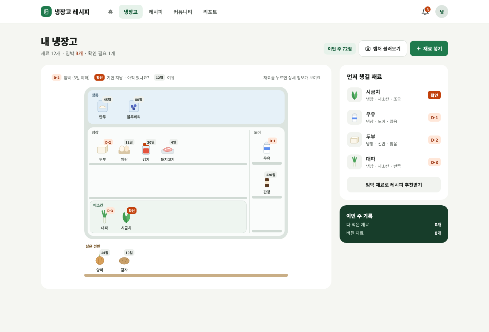
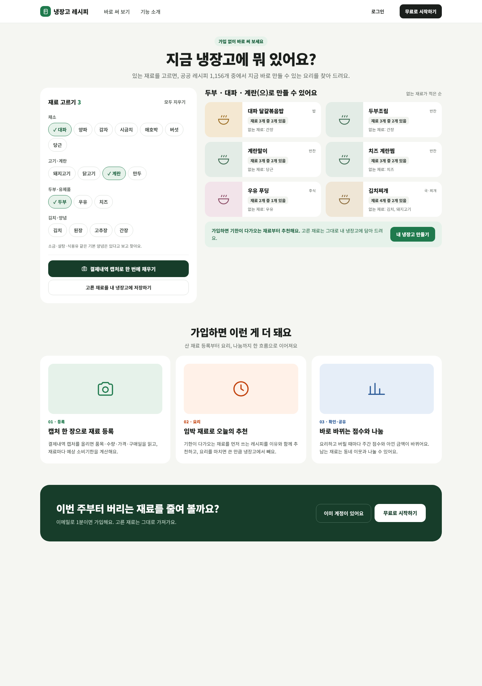
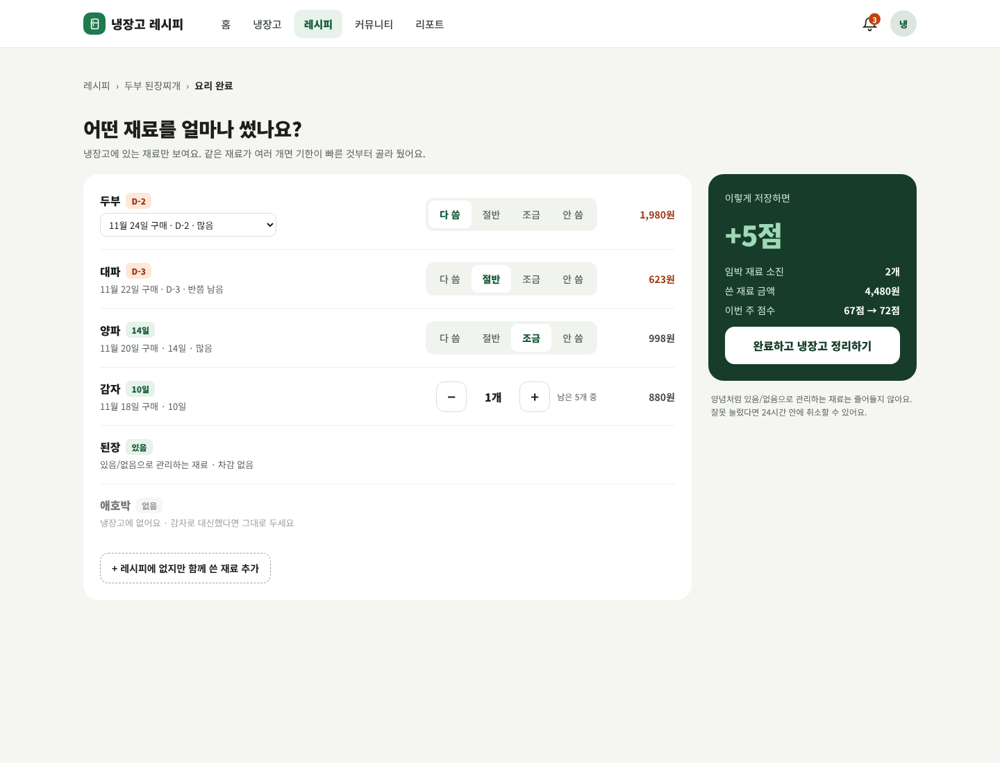

# 냉장고 레시피 추천 서비스 (가칭)

> 🚧 개발 진행 중입니다. 이 README는 팀 작업 안내서이며, 서비스 소개는 개발 완료 후 다시 정리합니다.

결제내역 캡처 한 장으로 식재료를 등록하고, 소비기한이 임박한 재료로 만들 수 있는 레시피를 추천하는 1인 가구용 냉장고 관리 웹 서비스입니다.

- **핵심 흐름**: 캡처 업로드 → 비전 LLM 인식 → 재고·예상 소비기한 등록 → RAG 레시피 추천 → 완료 체크·재고 차감 → 주간 점수 반영
- **함께 쓰는 기능**: 요리 피드·레시피 공유, 팔로우, 남는 재료 나눔 게시판, 식비·폐기 리포트, 뱃지
- **기술 스택**: Vue 3 · Django + DRF · PostgreSQL + pgvector · LLM API (비전·텍스트·임베딩)

자세한 내용은 [문서](#문서)를 참고하세요.

---

## Table of contents

- [문서](#문서)
- [화면 설계](#화면-설계)
- [개발 환경 (구성 예정)](#개발-환경-구성-예정)
- [개발 방식](#개발-방식)
- [브랜치 전략](#브랜치-전략)
- [커밋 규칙](#커밋-규칙)
- [PR 규칙](#pr-규칙)
- [코드 규칙](#코드-규칙)
- [진행 현황](#진행-현황)

---

## 문서

| 문서 | 내용 | 상태 |
| :--- | --- | :---: |
| [서비스 기획서](docs/Service_Plan.md) | 문제 정의, MVP 범위, 사용자·시스템 Flow, 기술 스택 | ✅ |
| [데이터 명세서](docs/Data_Specification.md) | 테이블·View 정의, 외부 데이터 수집 기준 | ✅ |
| [기능 명세서](docs/Feature_Specification.md) | 기능 ID별 동작, 입력, 처리 규칙, 예외, 우선순위 | ✅ |
| [화면 설계](docs/Wireframe.md) | 화면 목록(22개)과 기능 ID 매핑, 와이어프레임, 핵심 흐름 | ✅ |
| API 명세 | 엔드포인트, 요청·응답 형식 | ⬜ |

> 기능·API·화면·이슈·커밋은 모두 **기능 ID**(예: `INV-01`)로 연결합니다. 기능 ID 목록은 기능 명세서 1장을 참고하세요.

---

## 화면 설계

데스크톱 기준 22개 화면을 기능 명세서의 기능 ID에 맞춰 설계했습니다.
첫 화면은 로그인 대신 **가입 없이 재료를 골라 레시피를 먼저 보는 시작 화면**이며, 재료를 저장하거나 캡처 등록·요리 완료를 할 때 가입을 안내합니다.



| 시작 화면 | 요리 완료·재고 차감 |
| :---: | :---: |
|  |  |

- **주요 메뉴**: 홈 · 냉장고 · 레시피 · 커뮤니티 · 리포트 (오른쪽 위: 알림 · 마이페이지)
- **냉장고 화면**: 냉장고 그림 안에 재료를 배치하고, 다 쓰거나 버리면 그림에서 빠지고 등록하면 들어갑니다.
- **즉시 피드백**: 요리 완료·다 씀·버림·나눔 완료 직후 점수 변화와 이유를 보여주고 취소할 수 있습니다.

전체 화면 목록, 화면별 기능 ID, 흐름은 [화면 설계 문서](docs/Wireframe.md)를 참고하세요.

---

## 개발 환경 (구성 예정)

> 아직 개발 환경을 만들기 전입니다. 실제 실행 방법과 프로젝트 구조는 **개발 환경 구성 PR에서 코드와 함께 추가**합니다.

### 사용할 도구

| 구분 | 도구 |
| :--- | --- |
| 백엔드 | Python, Django + Django REST Framework |
| 프론트엔드 | Node.js, Vue 3 |
| 데이터베이스 | PostgreSQL + pgvector (로컬은 Docker로 실행) |
| 외부 API | 식품안전나라 레시피 DB(COOKRCP01), 비전·텍스트 LLM API, 임베딩 API |

### 레포 구성 방향

- 하나의 레포에 `docs/`(문서), `backend/`(Django), `frontend/`(Vue)를 함께 둡니다.
- Django 앱은 기능 영역(AUTH, INV, REC, COM, SCR, NOTI, RPT 등)에 맞춰 나눕니다.

### 필요한 환경변수

| 환경변수 | 설명 |
| :--- | --- |
| `DATABASE_URL` | PostgreSQL 접속 주소 |
| `FOODSAFETY_API_KEY` | 식품안전나라 레시피 DB(COOKRCP01) 인증키 |
| `LLM_API_KEY` | 비전·텍스트 LLM API 키 |
| `EMBEDDING_API_KEY` | 임베딩 API 키 |
| `STORAGE_*` | 이미지 저장소 설정 |

> 실제 키 값은 `.env`에만 두고 커밋하지 않습니다. 키는 팀 내부 채널로 공유합니다.

---

## 개발 방식

- **기능 ID 단위로 작업**합니다. 기능 하나 = 이슈 하나 = 브랜치 하나 = PR 하나가 기본입니다.
- **P0 → P1 순서**로 개발합니다. P0(핵심 흐름)이 끝까지 동작하기 전에는 P1을 시작하지 않습니다.
- **API 명세를 먼저 합의**하고, 백엔드와 프론트엔드가 명세 기준으로 동시에 작업합니다. 명세를 바꿀 때는 문서를 먼저 고치고 상대에게 알립니다.
- **문서가 기준**입니다. 구현하다가 기획·데이터 구조·화면·API가 바뀌면 해당 문서도 같은 PR에서 함께 수정합니다.
- **이슈 관리**: GitHub Issues에 기능 ID로 이슈를 만들고, Projects 보드(Todo / In Progress / Review / Done)로 진행 상황을 관리합니다.

---

## 브랜치 전략

```
master ← develop ← feature/*, fix/*, docs/*, refactor/*, chore/*
```

| 브랜치 | 용도 | 규칙 |
| :--- | --- | --- |
| `master` | 배포 브랜치 | 직접 push 금지, 마일스톤마다 develop에서 병합하고 태그(v0.1.0 등) |
| `develop` | 통합 브랜치 | 직접 push 금지, PR로만 병합 |
| `feature/{기능ID}-{설명}` | 기능 개발 | develop에서 분기 |
| `fix/{기능ID}-{설명}` | 버그 수정 | develop에서 분기 |
| `docs/{설명}` | 문서 수정 | develop에서 분기 |
| `refactor/{설명}` | 동작 변경 없는 구조 개선 | develop에서 분기 |
| `chore/{설명}` | 설정, 의존성, 빌드 | develop에서 분기 |

- 브랜치 이름은 영어 소문자와 하이픈 사용
- 예시: `feature/INV-01-capture-upload`, `fix/REC-05-deduct-rounding`, `docs/wireframe`
- 작업 시작 전 `develop`을 최신으로 받고 분기, PR 전 `develop`을 다시 반영해 충돌을 먼저 해결
- 문서 단계(개발 환경 구성 전)의 문서 PR은 master로 병합했으며, develop 생성 이후에는 모든 작업 브랜치를 develop에서 분기합니다.

---

## 커밋 규칙

```
type(scope): 요약

본문 (선택: 무엇을, 왜 바꿨는지)
```

| type | 설명 |
| :--- | --- |
| `feat` | 기능 추가 |
| `fix` | 버그 수정 |
| `docs` | 문서 수정 |
| `refactor` | 동작 변경 없는 코드 개선 |
| `style` | 포맷, 세미콜론 등 (로직 변경 없음) |
| `test` | 테스트 추가·수정 |
| `chore` | 설정, 의존성, 빌드 |
| `data` | 시드 데이터, 데이터 수집·적재 스크립트 |

- **scope**: 기능 ID 또는 앱 이름 (예: `INV-01`, `recipes`)
- **요약**: 한국어, 50자 이내, 마침표 없이, "무엇을 했다"로 작성
- 예시
  - `feat(INV-01): 캡처 업로드 및 비전 LLM 인식 API 추가`
  - `fix(REC-05): 절반 선택 시 차감량 반올림 오류 수정`
  - `data(recipes): COOKRCP01 수집 명령 추가`
  - `docs: 화면 설계 문서와 주요 화면 이미지 추가`
- 한 커밋에는 한 가지 변경만 담기

---

## PR 규칙

- **제목**: 커밋 규칙과 같은 형식 (예: `feat(INV-02): 인식 결과 확인·재고 저장`)
- **본문**: 관련 이슈(`Closes #12`), 변경 내용, 테스트 방법, 화면 변경이 있으면 스크린샷
- **리뷰**: 팀원 1명 승인 후 병합, 리뷰 요청 후 24시간 안에 확인
- **병합 방식**: Squash and merge (PR 하나 = develop 커밋 하나)
- **크기**: 리뷰하기 어려울 만큼 크면 나눠서 올리기 (기준: 변경 400줄 안팎)
- 병합 후 작업 브랜치 삭제

---

## 코드 규칙

### 공통
- 비밀 값(API 키, DB 비밀번호)은 `.env`에만 두고 절대 커밋하지 않기
- 날짜·시각은 DB에 TIMESTAMPTZ로 저장하고, 일·주 계산은 한국 시간(Asia/Seoul) 기준
- 금액은 원 단위 정수

### 백엔드 (Django)
- 포맷·린트: `ruff` (+ `ruff format`)
- 앱은 기능 영역별로 나누고, 테이블·컬럼 이름은 데이터 명세서를 따름
- API 경로는 `/api/v1/...`, 복수형 명사 사용 (예: `/api/v1/inventory-items/`)
- **마이그레이션**
  - `makemigrations` 전에 develop 최신 반영
  - 이미 develop에 병합된 마이그레이션 파일은 수정하지 않고 새 마이그레이션으로 변경
  - 같은 앱의 모델을 동시에 수정해야 하면 미리 공유
- 재고 이벤트와 점수 반영처럼 함께 바뀌어야 하는 처리는 하나의 트랜잭션으로 묶기
- 외부 API(LLM, 공공 데이터) 호출은 서비스 모듈로 분리하고 시간 제한·예외 처리 필수

### 프론트엔드 (Vue 3)
- 포맷·린트: ESLint + Prettier
- 컴포넌트는 PascalCase, Composition API 사용
- API 호출은 `api/` 모듈에 모아서 관리
- 데스크톱 화면 우선으로 작성하고, 모바일 대응은 이후 확장 (화면 설계 문서 기준)

---

## 진행 현황

> 마지막 업데이트: 2026-11-27

### ✅ 완료
- 서비스 기획서 작성 (팀 프로젝트 MVP 범위로 개편)
- 데이터 명세서 작성 (회원·커뮤니티·점수·알림·RAG 추천 로그 포함)
- 기능 명세서 작성 (기능 45개, 우선순위 P0 / P1 / P2, 비회원 체험 기능·냉장고 드래그 포함)
- 화면 설계 확정 (데스크톱 22개 화면, 가입 없이 써 보는 시작 화면)
- 외부 데이터 확인: 식품안전나라 COOKRCP01 호출 확인 (약 1,156건), 소비기한 참고값은 API가 없어 직접 구축으로 결정
- 데이터베이스 결정: PostgreSQL + pgvector

### 0. 문서·개발 환경 세팅
- [x] 서비스 기획서
- [x] 데이터 명세서
- [x] 기능 명세서
- [x] README (팀 작업 안내서)
- [x] 화면 설계 (화면 목록, 와이어프레임)
- [x] 기능 명세서에 비회원 기능(시작 화면 레시피 보기)·냉장고 드래그 반영
- [ ] API 명세
- [ ] develop 브랜치 생성, 브랜치 보호 규칙, 이슈·Projects 보드 생성
- [ ] 역할 분담·일정 확정
- [ ] Django·Vue 프로젝트 생성, docker-compose(PostgreSQL + pgvector), `.env.example`
- [ ] README에 실제 실행 방법·프로젝트 구조 추가
- [ ] 커스텀 User 모델 설정 (첫 마이그레이션 전)

### 1. 데이터 준비
- [ ] 식품안전나라 인증키 발급
- [ ] 레시피 수집·정제 (COOKRCP01)
- [ ] LLM 재료 분리·재료 그룹 매칭, 매칭 결과 검수
- [ ] 재료 그룹·표준 재료 100~150개, 소비기한 기준값 구축
- [ ] 시·군·구 시드, 점수 규칙·뱃지 시드
- [ ] 인식 평가용 결제내역 캡처 20~30장 수집, 정답 데이터 작성
- [ ] 비전 LLM 2~3개 비교 후 모델 선정, 임베딩 모델 선정

### 2. P0 백엔드
- [ ] AUTH-01·02 회원가입·로그인
- [ ] INV-01~06 캡처 인식, 재고 저장·조회·수정, 다 씀·버림
- [ ] REC-01·03·05·07 RAG 추천, 레시피 상세, 완료 체크·재고 차감, 비회원 레시피 보기
- [ ] SCR-01 점수 반영
- [ ] ADM-01·02 기준 데이터 관리, 레시피 적재

### 3. P0 프론트엔드
- [ ] 시작 화면(비회원 재료 선택·레시피 결과)·로그인·회원가입
- [ ] 캡처 업로드·인식 확인 화면
- [ ] 냉장고(재고 그림·상세 패널)
- [ ] 추천 목록·레시피 상세·요리 완료 화면
- [ ] 점수 변화 표시

### 4. P1 기능
- [ ] 프로필·탈퇴 (AUTH-03~05)
- [ ] 처리 취소, 기한 경과 확인, 냉장고 드래그 이동 (INV-07~09)
- [ ] 오늘의 냉장고 카드, 레시피 검색, 특정 재료 추천 (REC-02·04·06)
- [ ] 오늘의 변화, 주간 리포트, 월간 가계부 (RPT-01~03)
- [ ] 점수 게이지, 뱃지 (SCR-02·03)
- [ ] 피드, 레시피 공유, 나눔 게시판, 댓글, 반응, 팔로우 (COM-01~09)
- [ ] 알림 (NOTI-01·02)
- [ ] 배치 (BAT-01~03)

### 5. 배포·평가
- [ ] DB·이미지 저장소 호스팅 결정 (Supabase 또는 Render/Railway), pgvector 지원 확인
- [ ] 백엔드·프론트엔드 배포
- [ ] 인식 정확도, 추천 성과(노출 → 클릭 → 완료), LLM 검증 오류·대체 비율 측정
- [ ] 회고 및 서비스 소개용 README 재작성
