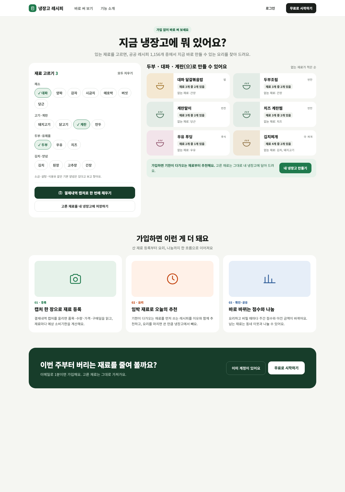
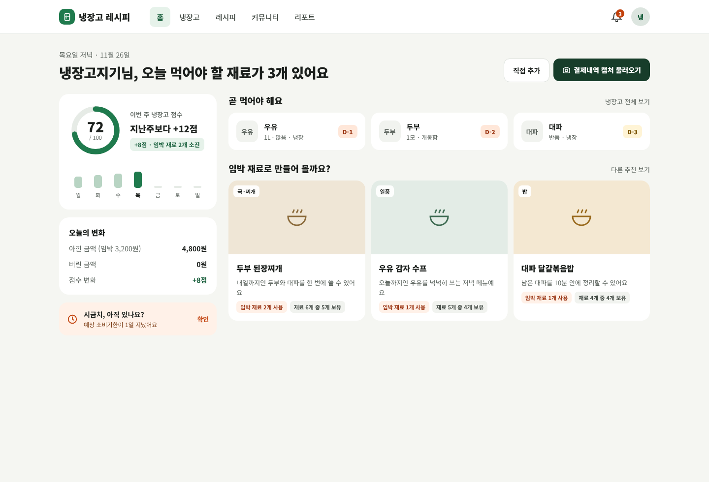
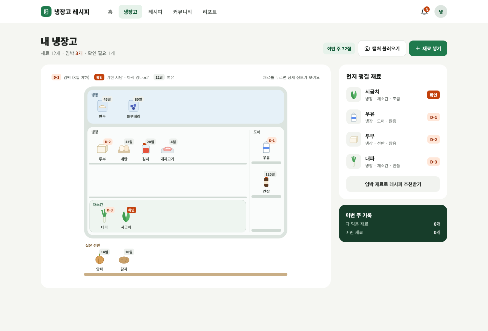
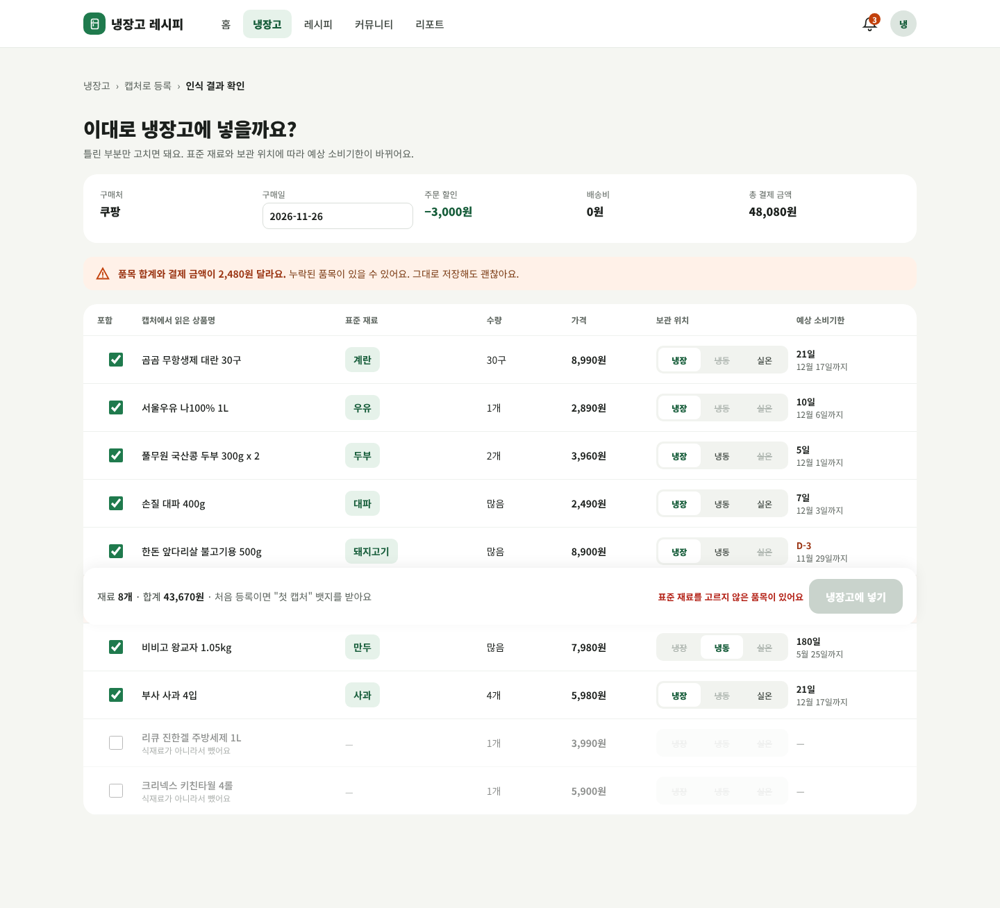
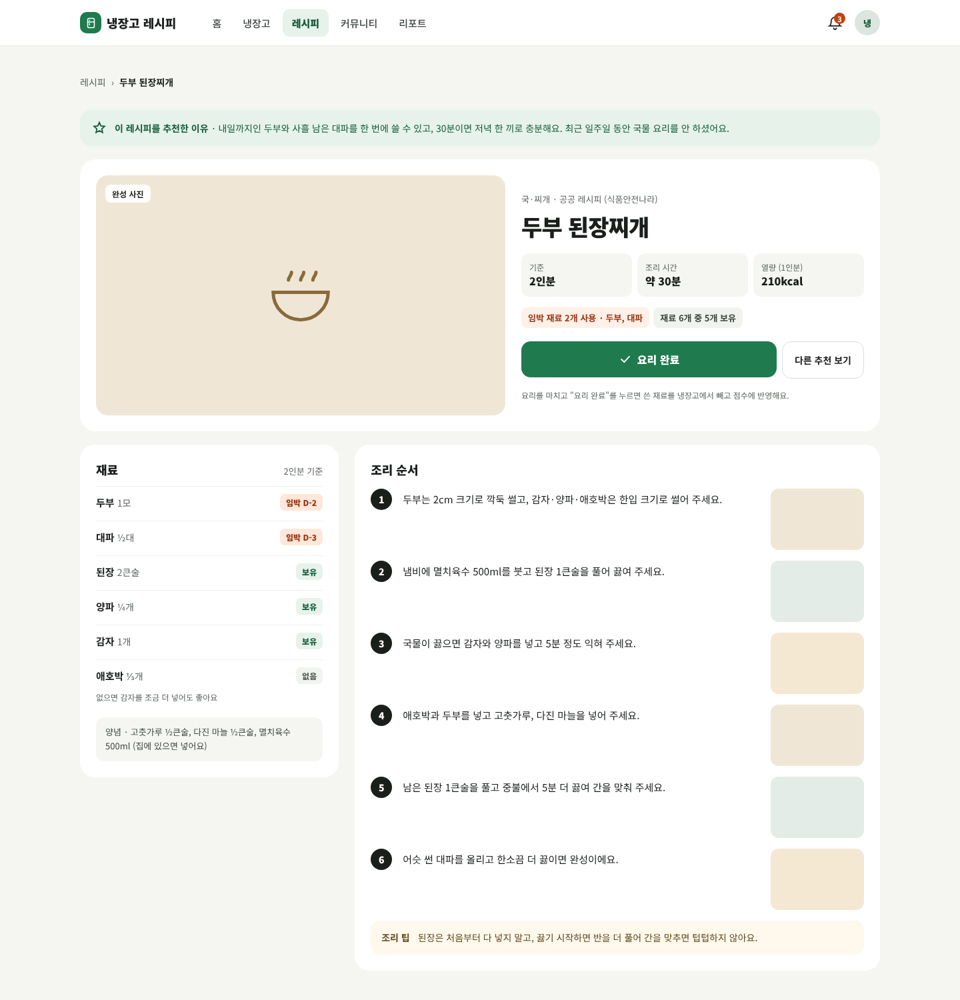
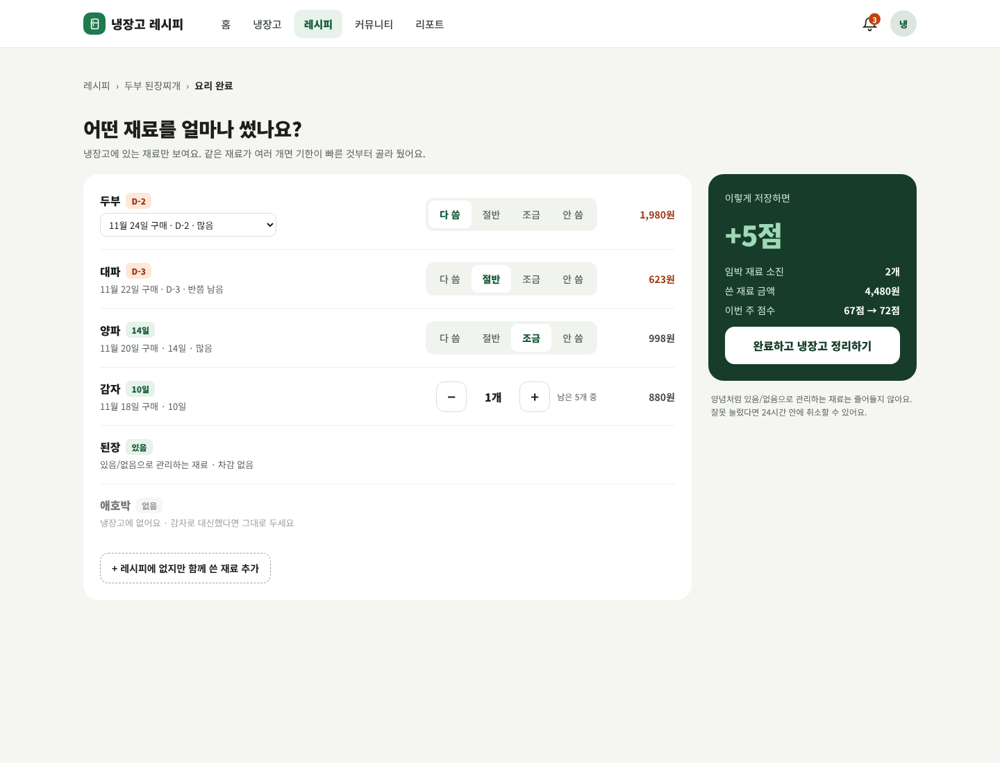
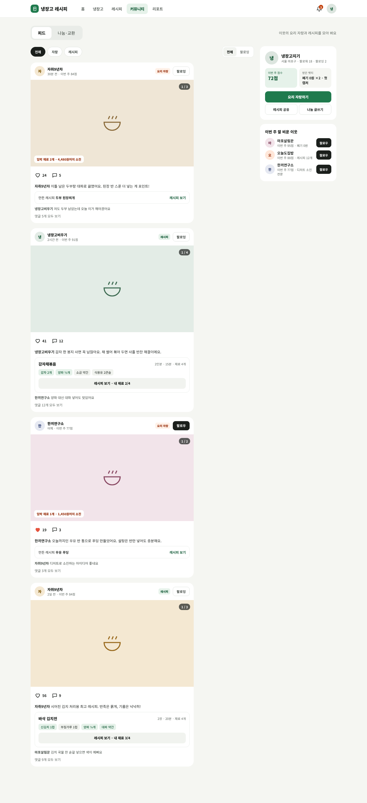
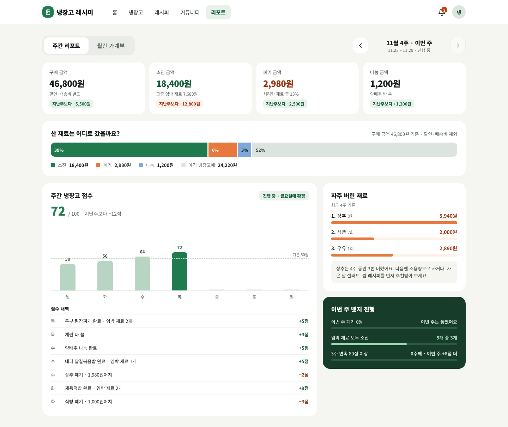

# 화면 설계 (와이어프레임)

```
기능 명세서의 기능 ID를 기준으로 데스크톱 화면 21개를 설계했습니다.
아래 이미지는 핵심 흐름을 보여주는 주요 화면 8개이며, 전체 화면 목록과 흐름은 표로 정리했습니다.
```

---

## 1. 설계 원칙

| 항목 | 내용 |
| :--- | --- |
| 대상 기기 | 데스크톱 우선 (모바일 대응은 이후 확장) |
| 첫 화면 | 로그인 대신 "가입 없이 써 보기" 시작 화면. 재료를 고르면 바로 레시피를 보여주고, 저장·캡처 등록·요리 완료 시점에 가입을 권함 (레이지 등록) |
| 주요 메뉴 | 상단 메뉴: 홈 · 냉장고 · 레시피 · 커뮤니티 · 리포트 / 오른쪽 위: 알림 · 마이페이지 |
| 스타일 | 오프화이트 배경(#F5F6F2) + 딥그린 메인 색(#1F7A4D), 임박·폐기는 오렌지 계열로 구분, 글꼴 Noto Sans KR |
| 냉장고 화면 | 냉장고 그림(냉동칸·냉장 선반·채소칸·도어·실온 선반) 안에 재료 그림을 배치, 처리하면 그림에서 빠지고 등록하면 들어감 |
| 즉시 피드백 | 다 씀·버림·요리 완료·나눔 완료 직후 "+N점 / -N점 · 이유" 알림과 취소 버튼 |

---

## 2. 주요 화면

### 시작 화면 (가입 없이 써 보기)


### 홈


### 냉장고


### 캡처 인식 결과 확인


### 레시피 상세


### 요리 완료 · 재고 차감


### 커뮤니티 (피드 / 나눔·교환)


### 리포트 (주간 리포트 / 월간 가계부)


---

## 3. 전체 화면 목록

| 흐름 | 화면 | 관련 기능 ID |
| :--- | --- | --- |
| ① 시작하기 | 시작 화면 (비회원 재료 선택 → 레시피 결과, 기능 소개, 가입 안내) | REC-04 (비회원용), AUTH-01 진입 |
| | 로그인 | AUTH-02 |
| | 회원가입 | AUTH-01 |
| | 오늘의 냉장고 카드 (로그인 직후 모달) | REC-02 |
| | 홈 | RPT-01, SCR-02, INV-04 요약, REC-01 |
| | 알림 | NOTI-01, NOTI-02 |
| ② 재료 등록·관리 | 캡처 업로드·인식 (업로드 / 인식 중 / 완료 / 실패) | INV-01 |
| | 인식 결과 확인·저장 | INV-02 |
| | 냉장고 (재고 그림·상세 패널·다 씀/버림·취소·재료 넣기) | INV-03~08 |
| ③ 추천·요리 | 레시피 (추천 5개 + 검색·필터) | REC-01, REC-04, REC-06 |
| | 레시피 상세 | REC-03 |
| | 요리 완료·재고 차감 (재고 선택·사용량 → 점수 결과) | REC-05, SCR-01, INV-07 |
| ④ 커뮤니티 | 커뮤니티 (피드 / 나눔·교환) | COM-01, COM-05, COM-08, COM-09 |
| | 게시글 상세·댓글 | COM-04, COM-07, COM-08 |
| | 요리 자랑 쓰기 | COM-02 |
| | 레시피 공유 쓰기 | COM-03 |
| | 나눔 글쓰기 | COM-06 |
| | 나눔 글 상세·거래 상태 변경 | COM-04, COM-06 |
| ⑤ 분석·마이 | 리포트 (주간 리포트 / 월간 가계부) | RPT-02, RPT-03, SCR-02, SCR-03 |
| | 마이페이지 (내 피드 · 나눔 글 · 뱃지 · 점수 내역) | AUTH-05, SCR-02, SCR-03 |
| | 설정 (프로필 · 비밀번호 · 회원 탈퇴) | AUTH-03, AUTH-04 |

---

## 4. 핵심 흐름

- **첫 방문**: 시작 화면 → 재료 선택 → 레시피 결과 → 레시피 상세(비회원 열람) / 저장·캡처 시도 → 가입 안내 → 회원가입 → 오늘의 냉장고 카드 → 홈
- **재방문**: 시작 화면 → 로그인 → 오늘의 냉장고 카드 → 홈
- **재료 등록**: 냉장고 → 캡처 불러오기 → 인식 중 → 인식 결과 확인 (재료 선택·보관 위치 수정) → 냉장고
- **요리**: 오늘의 냉장고 카드 → 레시피 상세 → 요리 완료 (사용량 선택) → 점수 결과 → 피드에 자랑하기 → 커뮤니티
- **나눔**: 냉장고 재료 상세 → 나눔하기 → 나눔 글쓰기 → 나눔 글 상세 → 거래 완료 (재고 정리·점수 반영)
- **확인**: 알림 → 냉장고 / 게시글 / 나눔 글 / 리포트 / 마이페이지

---

## 5. 구현 시 참고

- 비회원 기능은 "로그인 필요" 공통 규칙의 예외로 둠
  - 비회원 레시피 결과는 LLM 없이 재료 키워드 매칭(검색)으로만 제공
  - 캡처 인식·RAG 추천·요리 완료·글쓰기는 가입 후 사용
  - 비회원이 고른 재료는 브라우저에 임시 저장했다가 가입 직후 내 냉장고로 옮김
- 냉장고 칸별 재료가 많아지면 "더 보기" 펼치기 방식 필요
- 시안의 닉네임·지역·금액·레시피는 예시 값이며, 레시피 이미지는 공공 레시피 대표 이미지로 대체
